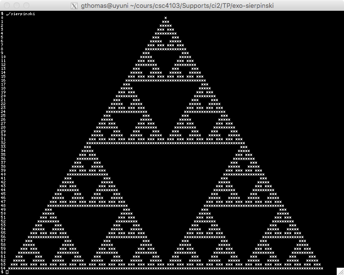
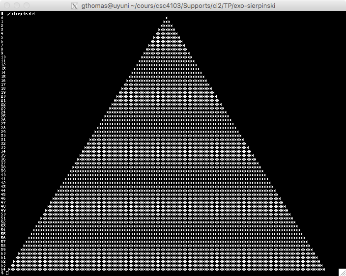
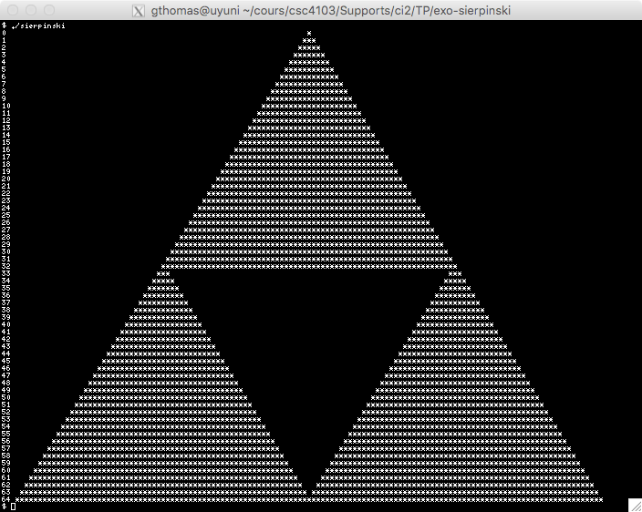
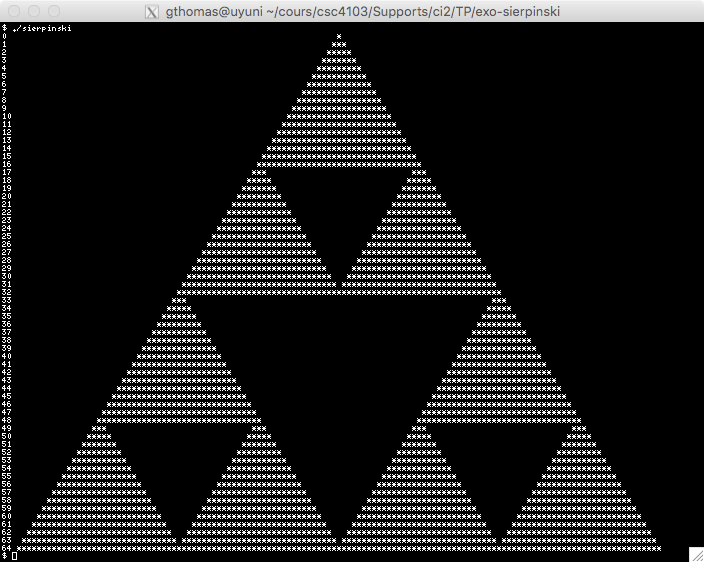
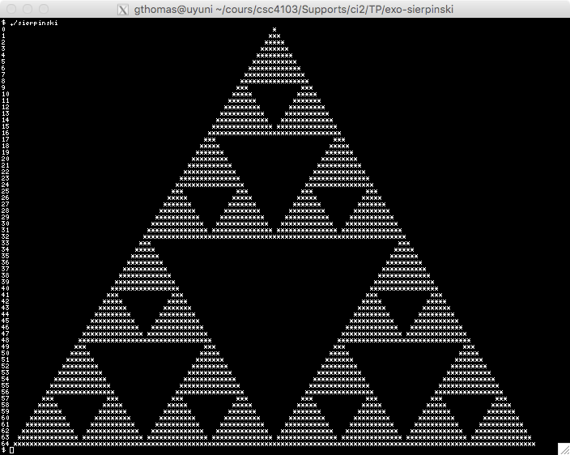
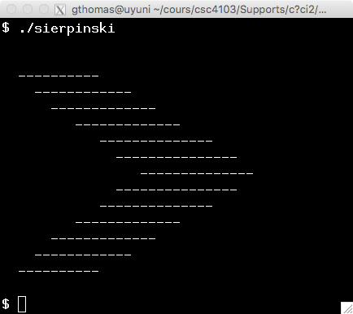
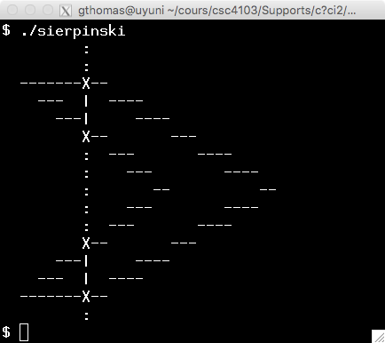

# The Sierpinski Triangle

The goal of this exercise is to create an approximation of the Sierpinski triangle as shown in the figure below.



This triangle is a fractal. It can be obtained by applying the algorithm illustrated in the figure below. At step 0, you start by drawing a triangle. Then, at step 1, you remove the central triangle, which leaves 3 triangles. At step 2, you repeat the process on the three triangles, thus creating 9 triangles. To move from step `n` to step `n + 1`, you apply the same algorithm: you remove the central triangles from the $3^n$ triangles of step `n`. The Sierpinski triangle is defined as the figure resulting from applying this algorithm infinitely many times.

| Step 0 | Step 1 | Step 2 | Step 3 |
| :---: | :---: | :---: | :---: |
|  |  |  |  |

In this exercise, we build the approximation of the triangle at step $n$. To do this, we use a slightly different algorithm, which involves directly drawing the $3^n$ triangles.

## Sorting

To build the Sierpinski triangle, we will need to sort an array of floating-point numbers. In this first part, we will implement the sorting algorithm. We use the insertion sort algorithm. This algorithm is not very efficient for sorting large sequences but proves to be particularly effective on small sequences.

The principle of the algorithm is illustrated below. To start, with the insertion sort algorithm, we ensure that an array is always sorted. To insert an element `n`, we traverse the array (step b) to find the position of `n` (step c). Once this position `i` is found, we shift all elements of the array to the right of position `i` (step d). Finally, we insert the number `n` into position `i` (step e).

```
+-----------------------+
| 1 | 3 | 5 | 7 |   |   |
+-----------------------+
 
a. Initial array

+-----------------------+
| 1 | 3 | 5 | 7 |   |   |
+-----------------------+
  ↑
b. Searching for position for 4

+-----------------------+
| 1 | 3 | 5 | 7 |   |   |
+-----------------------+
          ↑
c. Finds position for 4

+-----------------------+
| 1 | 3 | 5 | 5 | 7 |   |
+-----------------------+
          ↑
d. Shifts right

+-----------------------+
| 1 | 3 | 4 | 5 | 7 |   |
+-----------------------+
          ↑
e. Inserts 4
```

### Question 1

To begin, in the `main` function of `sierpinski.c`, declare an array named `tab` of **floating-point numbers** with 5 elements initialized to `1, 3, 5, 7, 0`. Then, print the 5 elements of the array using a loop in the terminal.

### Question 2

We now implement the search function. Write a function `sort_get_index` taking as arguments:

* an array of floats named `tab`,
* the current maximum index of the array `top` minus one (in other words, this argument gives the number of elements already inserted in the array),
* a float to insert `val`.

This function assumes that only the elements from `0` to `top-1` have been filled. It returns the index, between `0` and `top`, corresponding to the future position of the value `val` in the sorted array:

* The index, between `0` and `top-1`, containing the first value greater than `val` if it exists,
* The index `top` otherwise.

Test your function by displaying the insertion indices for the values 0, 3.5, and 10 using the array created in the previous question, where `top` is considered to be 4. Your program should produce an output similar to this:

```bash
$ ./sierpinski 
Insert 0 at 0, 3.5 at 2, 10 at 4
1.000000 3.000000 5.000000 7.000000 0.000000
```

> **Note:** Keep the code for displaying the array, as it will be useful for the following questions.

### Question 3

We will now implement the function to shift right and insert. Write a function `sort_insert_at` taking as arguments:

* an array of floats named `tab`,
* the insertion index `i`,
* the current maximum index of the array `top`,
* the floating-point number to insert `val`.

This function should shift to the right the elements between `i` and `top` before placing `val` at position `i`. Note that you have to start by shifting the elements from the right of the array to avoid overwriting values.

Test your function by inserting the value `3.5` at index `2` before displaying your array in the `main` function. Your program should produce output similar to this:

```bash
$ ./sierpinski 
Insert 0 at 0, 3.5 at 2, 10 at 4
1.000000 3.000000 3.500000 5.000000 7.000000
```

### Question 4

We can now write the insertion function. Write a function named `sort_insert` taking the same arguments as `sort_get_index`. This function should use `sort_get_index` and `sort_insert_at` to insert the new element.

Test your function by replacing the test of `sort_insert_at` with the insertion of the element `2`.

## Grids and Points

In this part, we create a finite grid. We represent a grid with `n` columns and `m` rows using a character array of size `n * m`. The first `n` elements contain the first row, the next `n` contain the second row, and so on.

### Question 5

To easily modify the size of our grid later, we define two functions named `int nb_columns()` and `int nb_lines()` which return the values 32 and 16, respectively. After removing the code that tests the sorting functions from the `main` function, display the dimensions of the grid in the `main` function to verify that your functions are correct.

### Question 6

In the `main` function, remove the display code, and instead create an array named `grid` of `nb_lines() * nb_columns()` characters. Set the first element of the grid to the value `*` and display this character.

### Question 7

Now that the grid is in place, we can initialize it. Write a function `grid_init` taking as arguments: (i) a character array `grid` and (ii) a character `pixel`. This function should initialize the `nb_lines() * nb_columns()` elements of the `grid` array to the value `pixel`.

In the `main` function, replace the initialization of the first character with the value `*` with initialization of the entire grid with the character `*`. Keep the display of the first element of the grid to verify that your program is correct.

### Question 8

The goal of this question is to write a function that displays the grid. Write a function `grid_display` taking as parameter a character array `grid`. This function should display, on each line of the terminal, a line of the grid.

In the `main` function, replace the display of the first element of the grid with the display of the entire grid.

### Question 9

Write a function named `plot_point` taking as parameters: (i) a grid `grid`, (ii) an integer coordinate `x`, (iii) an integer coordinate `y`, and (iv) a character `pixel`. This function should place the character `pixel` at position `(x, y)` in the grid.

In the exercise, we assume that the bottom-left corner of the grid corresponds to the point with coordinates `(0, 0)`. Therefore, placing the character `pixel` at coordinates `(x, y)` means placing the character `pixel` at the intersection of row `nb_lines() - y - 1` and column `x`.

To test your program, in the `main` function, place the space character (`' '`) at `(3, 1)`, and carefully check that your coordinate system is oriented correctly.

You should obtain the following output:

```
********************************
********************************
********************************
********************************
********************************
********************************
********************************
********************************
********************************
********************************
********************************
********************************
********************************
********************************
*** ****************************
********************************
```

### Question 10

To guard against potential bugs you might encounter, modify your `plot_point` function to display an error message and exit if `x` or `y` fall outside the grid. Verify that your code is correct by attempting to display the point with coordinates `(3, 100)`.

> **Note:** To exit a C program, you need to add the line `#include <stdlib.h>` at the beginning of the file and call the function `exit(EXIT_FAILURE)` at the point where you wish to exit.

## Vertical Lines (~ 20 minutes)

To draw the Sierpinski triangle, you need to be able to draw filled polygons. And to draw filled polygons, you will need to draw vertical lines. Drawing a vertical line is not a major challenge, but the problem becomes slightly more complicated as the coordinates of the polygons will be represented by floating-point numbers. You need to be able to project a vertical line represented by floating-point coordinates onto a grid using integer coordinates.

### Question 11

Write a function `plot_vline` that takes as parameters:

* a character array `grid`,
* an **integer** x-coordinate `x`,
* a **floating-point** y-coordinate `fy0`,
* a **floating-point** y-coordinate `fy1`,
* a character `pixel`.

The function `plot_vline` should draw each of the points of the vertical line `(x, fy0)` to `(x, fy1)` in the `grid` using the character `pixel`. It is assumed that `fy1` is greater than or equal to `fy0` (this will be the case, as these y-coordinates will come from a sorted array).

As a first approximation, we suggest converting `fy0` to an integer variable `y0` and `fy1` to an integer variable `y1`, then drawing each of the points on the x-axis that fall between `y0` and `y1` **inclusive**.

To test your program, start by initializing the grid with the space character (' ') instead of the '*' character. Then, draw the line from `(1, 2)` to `(1, 3)` using the character '|' with `plot_vline`. This program should draw a line including the points `(1, 2)` and `(1, 3)`.

### Question 12

We are now dealing with correctly converting floating-point numbers to integers. Initially, we want to round the floating-point number to the nearest integer value. This way, the segment `[1.2, 3.8]` will be converted to `[1, 4]` and the segment `[1.7, 3.3]` to `[2, 3]`. This rounding provides a relatively aesthetic graphical result.

Unfortunately, converting a floating-point number to an integer in C simply truncates the decimal part of the floating-point number. Thus, currently, the number 3.8 is converted to 3, which is not what we expect. However, you may notice that if we round a floating-point number `f` by truncating the decimal part of `f + 0.5`, you get exactly the rounding we expect: 1.2 is converted to $E(1.2 + 0.5) = 1$ and 3.8 to $E(3.8 + 0.5) = 4$.

Modify your function `plot_vline` to perform this rounding. Test your rounding by drawing, after the line (1, 2) to (1, 3), the lines (2, 1.7) to (2, 3.3) and (3, 1.2) to (3, 3.8).

### Question 13

Now we face the problem of rounding numbers with a decimal part of exactly 0.5. Indeed, we could project the segment [0.5, 1.5] to [0, 2], [0, 1], [1, 2], or [1, 1]. All these solutions are correct, of course, but it is more aesthetic to restrict to symmetric projections around 1: either [0, 2] or [1, 1]. With our current algorithm, the number 0.5 is converted to 1 and the number 1.5 to 2, which is not suitable. To adopt the first solution, we suggest subtracting 1 from `y0` if `fy0` is equal to `y0 - 0.5`, i.e., if the decimal part of `fy0` is equal to 0.5.

Test your function by adding the line from (7, 0.5) to (7, 1.5) to your grid. The figure you should obtain at this stage is as follows:

```
   |                            
 |||                            
 |||   |                        
   |   |                        
       |
```

## Beautiful Polygons (~ 1h10)

We can now start drawing the polygons that will be used to draw the Sierpinski triangle. The figure below presents the principle. A polygon is defined by a set of points called the vertices of the polygon. The goal of this part is to fill a polygon from its points. For example, the polygon represented in the figure below is defined by the points (2, 13), (10, 13), (30, 7), (10, 1), (2, 1), (18, 7).

| a. The filled polygon | b. Sweeping the axis 9 |
| :---: | :---: |
|  |  |

To fill the polygon, we sweep the figure along the x-axis. Figure b represents the sweeping of axis 9. When sweeping an axis, we start by identifying all the intersections between the swept axis and the sides of the polygon. In our figure, by sweeping axis 9, we get the points (9, 1), (9, 3.625), (9, 10.375), and (9, 13) represented by the symbol `X` on the figure.

By sorting these points along the y-axis, we see that this sequence gives exactly the vertical lines to draw if we take the points two by two: in our case, it is enough to draw the lines (9, 1) to (9, 3.625) and (9, 10.325) to (9, 13).

### Question 14

We begin by setting up the definition of a polygon and the sweeping algorithm. For this, you need to:

* Define a structure named `point` containing two floating-point fields named `x` and `y`.
* Write a function named `plot_poly_sweep` that takes a grid, an array of points, the number of points in the array, the x-coordinate of the swept axis (an integer), and a pixel (a character). For now, this function should display the swept axis.
* Write a function named `plot_poly` that takes a grid, an array of points, the number of points in the array, and a pixel (a character). This function should iterate with a variable `x` over the values 0 to `nb_columns()` and call `plot_poly_sweep` for each swept axis.
* Remove from the `main` function the construction of the lines requested in the previous part, but keep the definition of the grid, its initialization, and its display.
* Create an array of points named `p` in the `main` function. This array should be initialized with the following points: `{ 2, 13 }, { 10, 13 }, { 30, 7 }, { 10, 1 }, { 2, 1 }, { 18, 7 }` (be sure to copy/paste this line into your program).
* Call the `plot_poly` function from the `main` function, between the initialization and the display of the grid.

When you run your program, you should get an output similar to this:

```bash
$ ./sierpinski 
sweep 0:
sweep 1:
...
sweep 30:
sweep 31:
                                                                
...
```

### Question 15

In order to find the intersection points between the swept x-axis and the sides of the polygon, we will iterate over each side of the polygon in the `plot_poly_sweep` function. Technically, iterating over the sides of the polygon is equivalent to iterating over the set of pairs: `(p[n-1], p[0]), (p[0], p[1]), (p[1], p[2]), ..., (p[n-2], p[n-1])`, where `n` is the number of points of the polygon. In each iteration, the variable `j` should be the index of the left element of a pair and the variable `i` should be the index of the right element. In this question, we will only display these pairs (not their values: only their indexes). The output produced by your program should thus now be similar to this since our polygon has 5 vertices:

```bash
$ ./sierpinski 
sweep 0: (5, 0) (0, 1) (1, 2) (2, 3) (3, 4) (4, 5)
sweep 1: (5, 0) (0, 1) (1, 2) (2, 3) (3, 4) (4, 5)
...
```

### Question 16

For each side of the polygon, we want to know if the x-axis crosses this side, and at which point:

* To check if the x-axis may cross the side, simply verify that x is between `p[i].x` and `p[j].x` or between `p[j].x` and `p[i].x`.
* To find the potential intersection point between a side and an x-axis, some basic geometry is required. If you take the time to set up the problem, you would find easily (we hope) that this intersection point is `p[i].y + (x - p[i].x) * (p[j].y - p[i].y) / (p[j].x - p[i].x)` since the slope of the line passing through `p[i]` and `p[j]` is `(p[j].y - p[i].y) / (p[j].x - p[i].x)`.

Start by removing the display of the pairs in your loop. Then, for each swept x-axis, instead, display the potential intersection point between the side and the x-axis.

You should get an output similar to this:

```
...
sweep 2:  13.000000  13.000000  1.000000  1.000000
sweep 3:  12.625000  13.000000  1.000000  1.375000
...
sweep 9:  10.375000  13.000000  1.000000  3.625000
sweep 10:  10.000000  13.000000  13.000000  1.000000  1.000000  4.000000
sweep 11:  9.625000  12.700000  1.300000  4.375000
...
sweep 28:  7.600000  6.400000
sweep 29:  7.300000  6.700000
sweep 30:  7.000000  7.000000
...
```

### Question 17

The algorithm you just implemented is not yet completely correct because some points (the corners) appear multiple times. In some cases, they need to appear, in others, they should not (especially on axis 10). However, before fixing this issue, we will draw the vertical lines: it is much easier to reason and correct a drawing rather than a series of points.

Before we can draw our lines, they need to be sorted. For this, we will reuse the `sort_insert` function defined in the first step. Modify your `plot_poly_sweep` function to:

* Create an uninitialized array of `n * 4` floats named `vlines` at the beginning of the function (where `n` is the number of points passed as a parameter to the function),
* Define a variable named `top` to keep track of how many points are currently in this array,
* Remove the display of the intersection point and replace it with adding the intersection point to the `vlines` array using the `sort_insert` function,
* Display the points in the array after the loop that iterates over each side. You should get the same display as before, but the points should now be sorted.

### Question 18

We can now draw the polygon. After displaying the intersection points, draw the lines by pairing the points in the array. Typically, if the intersection points are `{ 1, 1.375, 12.625, 13 }`, you need to display the vertical lines `[1, 1.375]` and `[12.625, 13]` on the x-axis. You may notice that your polygon is almost correct, except for axis 10, where some vertical lines are reversed:

```
 ----------                    
   ------ -----                
     ---- --------             
         -------------         
          - --------------     
          -   ---------------  
          -     -------------- 
          -   ---------------  
          - --------------     
         -------------         
     ---- --------             
   ------ -----                
 ----------                    
```

### Question 19

We are now fixing the problem with axis 10. The issue is that points 1 and 13 appear twice instead of once. For example, for point 1, this phenomenon is due to the fact that axis 10 intersects the line from (30, 7) to (10, 1), but also the line from (10, 1) to (2, 1).

To count these points only once, you should cut the plane between `[0, x]` and `]x, nb_columns()]`: if `[p[i].x, p[j].x]` cuts the right part of the plane, count the intersection; otherwise, ignore it. For the case of point 1, we will count the side from (30, 7) to (10, 1), but not the one from (2, 1) to (10, 1). This invariant can be reformulated as follows:

* If `p[i].x <= p[j].x`, then we consider an intersection if `p[i].x <= x` and `x < p[j].x`,
* If `p[j].x <= p[i].x`, then we consider an intersection if `p[j].x <= x` and `x < p[i].x`.

Noting that the "If" part of our invariant is implied by the "Then" part, correct your program. You should obtain the following result:

```
 ----------                    
   ------------                
     -------------             
         -------------         
            --------------     
              ---------------  
                -------------  
              ---------------  
            --------------     
         -------------         
     -------------             
   ------------                
 ----------                    
```

### Question 20 (optional)

Our polygon is almost correct. However, some corners are no longer drawn, particularly point (30, 7) since the sides associated with this point are to the left in the plane. Similarly, a vertical line to the right of the figure would no longer be drawn. This result is acceptable if the resolution is high. However, if you want to correct this problem, you can slightly enrich your algorithm by drawing the missing points and lines in the loop that iterates over the sides:

* If `p[i].x` is equal to `x`, then:
  * If `p[j].x` is equal to `x`, we are dealing with a vertical side. We draw this side directly using `plot_vline`. Remember to consider the case where `p[i].y < p[j].y` and the reverse case because `plot_vline` needs to receive the arguments `fy1` and `fy2` in the correct order.
  * Otherwise, we are dealing with a corner. We draw the point directly using `plot_vline` to draw a line from `p[i].y` to `p[i].y`.
* Then, whether or not `p[i].x` is equal to `x`, we handle adding the intersection point as in the previous question.

## The triangle (optional)

Now that we can draw polygons, we can finally draw this Sierpinski triangle.

### Question 21

Write a `plot_triangle` function taking as parameters a grid, three points `p1`, `p2`, and `p3` and a pixel. This function should display the filled triangle using `plot_poly`.

Remove the displays done in the `plot_poly` function. Also remove the old tests from your `main` function. Finally, modify the size of your grid to have 65 rows and 129 columns and draw a filled triangle with coordinates (0, 0), (64, 64), (128, 0).

### Question 22

Since you will need to find the midpoints of the sides of the Sierpinski triangles, write a function named `line_middle` taking as parameters two points and returning the point at the midpoint of the segment.

### Question 23

Finally, write a recursive `sierpinski` function taking as parameters a grid, three points, a number `n` of remaining iterations and a pixel. This function should display the triangle if `n` equals 1, otherwise, this function should call `sierpinski` three times with each of the remaining full triangles at step `n-1`. Test your function with 6 iterations. You should get the result given at the beginning of the exercise.

---

🎉 **Congratulations! You have just written your first simple graphics engine!**